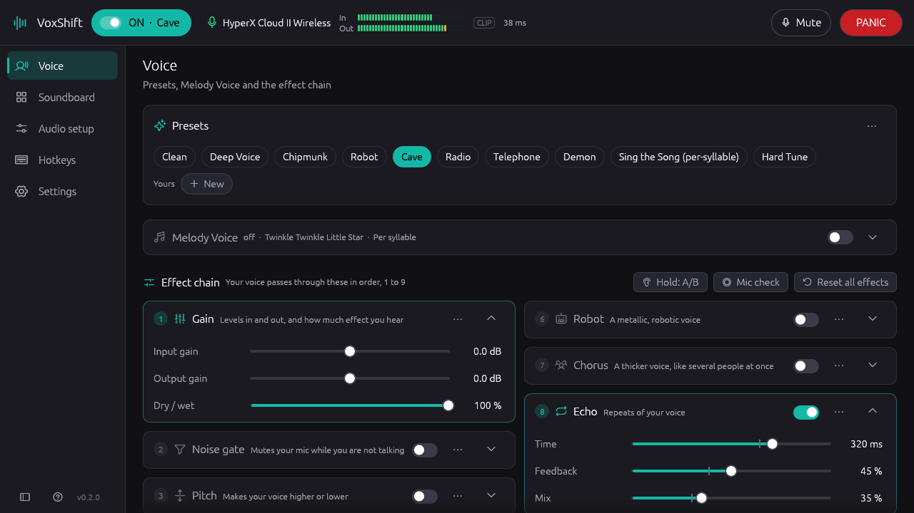

# VoxShift

**A free voice changer and soundboard for Windows that runs entirely on your own PC.**

VoxShift takes your microphone, changes your voice in real time, mixes in sound clips, and
sends the result to a *virtual microphone*. Discord, OBS, games or any other app then use that
virtual microphone instead of your real one, so they hear the changed voice and your sounds.

Everything runs locally. There's no account, no cloud service, no ads and no telemetry, and
nothing is uploaded anywhere.



## Features

- **Voice effects:** pitch, noise gate, EQ, distortion, robot, chorus, echo and reverb, with
  ready-made presets (Deep Voice, Chipmunk, Robot, Demon, Radio, ...) and your own.
- **Melody Voice:** talk and it comes out *sung* to a melody, or auto-tuned to a key. Use the
  built-in tunes or your own MIDI files.
- **Soundboard:** play wav, mp3, ogg or flac clips into your mic, with folders, favourites,
  hotkeys, trim and fades, play modes (hold, toggle, loop) and a headphones-only preview.
- **Backup mic:** if your main mic is unplugged or goes silent, VoxShift switches to a second
  mic without interrupting the virtual mic.
- **Panic button:** instantly stops all sounds and sends only your clean voice.
- **Global hotkeys** that work while a game has focus, a **mic check** that plays back what
  others hear, tray icon, start with Windows, dark and light themes.
- **Share** your presets and melodies with friends in one `.voxpack` file.

The [user guide](docs/GUIDE.md) explains every page and setting.

## Getting started

You need **Windows** (64-bit), a microphone, and preferably headphones (with speakers you get
echo).

1. **Install VB-CABLE** (once), a free virtual audio cable driver:
   <https://vb-audio.com/Cable/>. It adds two devices: VoxShift plays *into* **CABLE Input**,
   and other apps *listen to* **CABLE Output**. Don't make CABLE Input your default playback
   device, or every Windows sound ends up in your mic.
2. **Download `VoxShift.exe`** from the **[Releases page](../../releases/latest)** and run it.
   There's no installer. If Windows says *"Windows protected your PC"*, click **More info →
   Run anyway** (the exe isn't signed with a paid certificate).
3. **Follow the setup wizard:** it checks VB-CABLE, lets you pick your mic and runs a mic check.
4. **Pick CABLE Output as the microphone** in Discord, OBS or your game.
   - **Discord:** also turn off noise suppression, echo cancellation and automatic gain control,
     or they filter out the effects.
   - **OBS:** mute any source that records your real mic, or you'll be heard twice.
   - **Games without a mic setting:** set CABLE Output as the Windows default input device.

Then pick a preset on the **Voice** page and talk. The **Audio setup** page shows a green,
orange or red dot for each step of the path if something doesn't work.

## Troubleshooting

- **Nobody hears me, or they hear my normal voice:** the other app must use **CABLE Output**
  (not CABLE Input or your real mic), and the header pill must say **ON**.
- **I hear an echo:** use headphones, and make sure no other app also records your real mic.
- **No preview, mic check or beeps:** these play on the monitor. Turn it on under **Audio setup
  → Monitor**.

More answers are in the [FAQ](docs/GUIDE.md#faq-and-troubleshooting).

## Limitations

- Windows only, and VB-CABLE is required for other apps to hear you.
- Your voice reaches other apps a few tens of milliseconds late; Pitch and Melody Voice add
  more. Fine for voice chat.
- Big pitch jumps sound grainier than small ones.
- The exe is not code-signed, so SmartScreen and some antivirus programs warn about it.

## Building from source

You need Windows and [Rust](https://rustup.rs) (stable, MSVC or GNU toolchain).

```powershell
git clone https://github.com/Jarne-M/voxshift.git
cd voxshift
cargo run --release          # build and start
cargo test
cargo clippy --all-targets -- -D warnings
```

The result is a single exe with no extra files. `build.cmd` and `env.ps1` are only for a
portable Rust toolchain in a `.toolchain` folder next to the project.

A few tests need an interactive desktop (they inject a key or show a tray icon), so don't type
while they run. See [docs/TESTING.md](docs/TESTING.md) for manual tests, and
[docs/ARCHITECTURE.md](docs/ARCHITECTURE.md) for how the code is organised. In short: a
real-time audio thread that never locks or allocates, with the device manager, hotkeys, tray and
window on their own threads. It's written in Rust with [egui](https://github.com/emilk/egui)
and [cpal](https://github.com/RustAudio/cpal).

Command-line options: `--list-devices`, `--selftest` (`--selftest switch` also simulates
unplugging the mic) and `--config <file>` for a second settings profile.

## Contributing

Bug reports, ideas and pull requests are welcome. Run `cargo test` and `cargo clippy` before
opening a pull request; GitHub Actions builds and tests it on Windows. Nothing on the audio
path may lock, allocate or block.

**Releases** (for maintainers): bump `version` in `Cargo.toml`, commit, and push a tag such as
`v0.2.0`. GitHub Actions builds the exe and publishes the release.

## Responsible use

VoxShift is meant for fun with friends, streaming and privacy. Don't use it to impersonate,
deceive, harass or defraud anyone; follow the rules of the platforms and games you use it in;
and only use sound clips and MIDI files you have the right to use. VoxShift doesn't come with
any songs; the built-in melodies are public domain.

## License

VoxShift is released under the [MIT License](LICENSE).

## Credits

- **VB-CABLE** by [VB-Audio](https://vb-audio.com/Cable/), a separate product with its own
  license that isn't included.
- Built with [cpal](https://github.com/RustAudio/cpal),
  [egui / eframe](https://github.com/emilk/egui),
  [egui-phosphor](https://github.com/amPerl/egui-phosphor),
  [symphonia](https://github.com/pdeljanov/Symphonia),
  [rubato](https://github.com/HEnquist/rubato), [midly](https://github.com/kovaxis/midly),
  [rtrb](https://github.com/mgeier/rtrb), [rfd](https://github.com/PolyMeilex/rfd),
  [serde](https://serde.rs) and [windows-sys](https://github.com/microsoft/windows-rs). Thank
  you!
- Icons from [Phosphor Icons](https://phosphoricons.com) (MIT).
