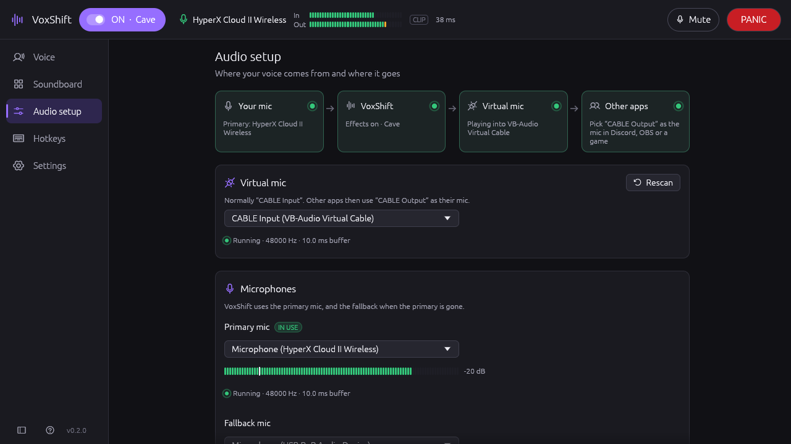
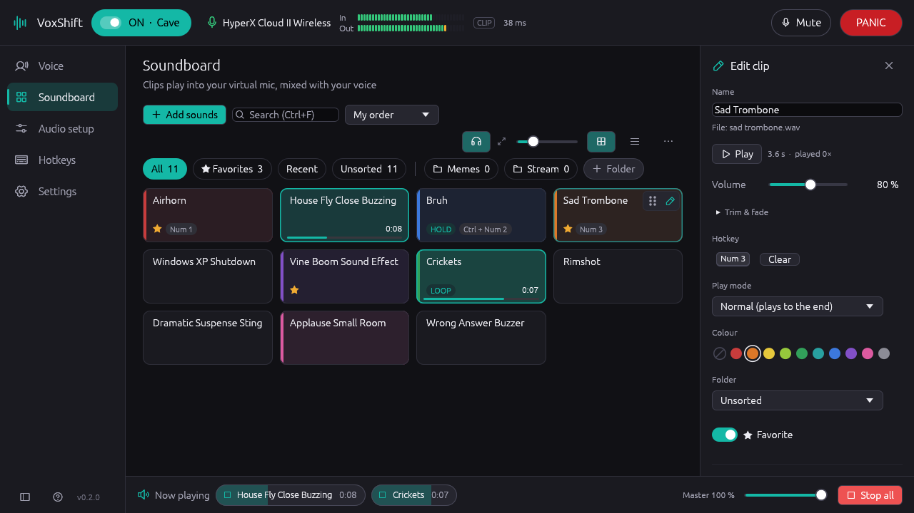
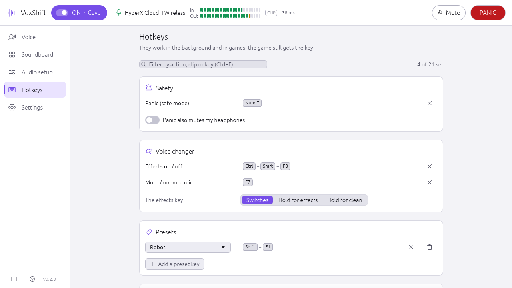

# VoxShift user guide

Everything VoxShift can do, page by page. To install it and get started, see the
[README](../README.md#getting-started).

## Contents

- [The window](#the-window)
- [Voice changer and effects](#voice-changer-and-effects)
- [Presets and sharing](#presets-and-sharing)
- [Melody Voice](#melody-voice)
- [Soundboard](#soundboard)
- [Audio setup: microphones, monitor and latency](#audio-setup-microphones-monitor-and-latency)
- [Panic button (safe mode)](#panic-button-safe-mode)
- [Tray icon, closing and startup](#tray-icon-closing-and-startup)
- [Hotkeys](#hotkeys)
- [Keyboard shortcuts in the window](#keyboard-shortcuts-in-the-window)
- [Settings](#settings)
- [FAQ and troubleshooting](#faq-and-troubleshooting)

## The window

**The header** is always visible:

- **The voice changer switch**, a pill that reads **ON · *preset*** (filled) or
  **OFF · clean voice** (outlined). Click it, or press Space.
- The active mic (hover it to see why that one is in use), the **In** and **Out** meters, the
  red **CLIP** lamp and the estimated delay.
- **Status chips** that only appear when something needs attention, such as *VB-CABLE not
  found*, *Using fallback mic*, *No microphone* or *Mic muted*. Click one to go to where you
  can fix it.
- **Mute** and the red **PANIC** button on the right.

**The navigation rail** on the left has five pages. VoxShift opens on the page you used last.

| Page | What's on it |
|---|---|
| **Voice** | presets, Melody Voice, the effect chain, A/B compare and mic check |
| **Soundboard** | your clips, folders, search, the edit panel and "Now playing" |
| **Audio setup** | the signal path, virtual mic, microphones, monitor and latency |
| **Hotkeys** | every global hotkey in one list |
| **Settings** | theme, UI scale and accent colour, window and startup, switch feedback, the settings file, About |

The button at the bottom left folds the rail to icons only; **?** lists the keyboard
shortcuts. Messages (mic switched, preset saved, clip deleted, import results, errors) appear
for a few seconds at the bottom right.

**Every slider** works the same way: drag or click the track, **Ctrl+drag** for fine steps,
the **mouse wheel** while you point at it, or click the value to type one. **Double-click or
right-click** puts it back to its default, which is marked with a small line on the track.
Hover a slider or button to see what it does.

## Voice changer and effects

- The **ON/OFF** pill in the header switches all effects at once. OFF sends your clean voice,
  and the effect chain is dimmed with a note saying so. Switching is a short crossfade, never a
  click, and it doesn't change your sliders: switching back gives exactly what you had. An
  echo or reverb that's still sounding fades out naturally.
- **Mute** silences your mic. Soundboard clips still play.
- The meters show your input and output level. The red **CLIP** lamp lights up when the
  output is too loud and gets distorted: lower the output gain.

The **effect chain** on the Voice page lists the effects in the order your voice passes
through them, 1 to 9. Each card has a switch, a short description and a **⋯** menu with
**Reset to defaults**. An effect that's off folds to one line; the arrow opens or closes any
card by hand.

| Effect | What it does |
|---|---|
| **Gain** | Input gain (how loud your mic comes in), output gain, and dry/wet (how much of the effect you hear versus your clean voice). |
| **Noise gate** | Mutes your mic when you're not talking, to cut background noise. |
| **Pitch** | Makes your voice higher or lower, up to 12 semitones (one octave). *Preserve formants* keeps it sounding like you instead of a chipmunk or a giant. |
| **Tone** | Low cut, high cut and a 3-band EQ (bass, mids, treble). |
| **Distortion** | A crunchy, overdriven sound. |
| **Robot** | A metallic, robotic voice. |
| **Chorus** | A thicker voice, as if several people talk at once. |
| **Echo** | Repeats of your voice. |
| **Reverb** | Room or hall sound. |

Every slider change is smooth, so you can adjust things while talking. Above the chain:

- **Hold: A/B**: while you hold it, *you* hear your clean voice in your headphones; let go to
  hear the effects again. Others keep hearing the effects. (The monitor must be on.)
- **Mic check**: records five seconds of exactly what the virtual mic sends (your voice with
  its effects, plus any clip), then plays it back in your headphones. Click again to stop.
- **Reset all effects**: everything back to the *Clean* preset. Your input gain is kept.

## Presets and sharing

The **Presets** card sits at the top of the Voice page.

- **Built-in presets:** Clean, Deep Voice, Chipmunk, Robot, Cave, Radio, Telephone, Demon,
  Sing the Song (per-syllable) and Hard Tune. Click one to load it. They can't be overwritten.
- **Your own** presets follow after **Yours**, favourites first (marked with ★). Click
  **+ New** to save the current settings under a name. Right-click one of your presets to
  **Rename**, add it to or remove it from the favourites, **Replace with the current
  settings**, or **Delete** it. Favourites are also quick picks in the
  [tray menu](#tray-icon-closing-and-startup). A preset saved with Melody Voice on also remembers its melody.
- When you change a slider after loading a preset, its chip gets a dot and **Save** and
  **Revert** appear. *Save* updates your own preset (for a built-in one it asks for a new
  name); *Revert* goes back to the preset as it was saved.
- The **⋯** menu of the card has **Save as a new preset…**, **Share…** and **Import…**.
  - **Share…** saves all your own presets and imported MIDI files in one `.voxpack` file.
  - **Import…** (or dropping a `.voxpack` on the window) adds the presets and melodies from such
    a file. Your own presets are kept. A name you already use gets "(2)", and importing the same
    pack twice adds nothing.

Soundboard clips aren't part of a `.voxpack`; send those files separately.

## Melody Voice

Melody Voice is the section between the presets and the effect chain. While it's off it's a
single line (*Melody Voice · off · melody · mode*); the arrow opens it. Turn it **on**, pick a
melody and talk: each syllable comes out on the next note of the song. Sounds like "s", "t",
"f" and breaths pass through unchanged, so you stay understandable. The easiest start is the
*Sing the Song (per-syllable)* preset: say a sentence slowly, one syllable at a time.

**Modes**

| Mode | When it moves to the next note |
|---|---|
| **Per syllable** (default) | On every new syllable. *Sensitivity* sets how easily a new syllable is detected; *Min note length* stops glitches from skipping notes (both under *Advanced*). |
| **Tempo-synced** | The song plays at the **Tempo** you set, starting when you start making sound. |
| **Manual step (hotkey)** | Only when you click **Next note** or press its hotkey. |
| **Scale snap (auto-tune)** | No melody: your voice is pulled to the nearest note of a **Key** and scale (major, minor, major or minor pentatonic, chromatic). |

**Melodies**

- **Built in** (all public domain, written into the app as notes): Ode to Joy, Twinkle
  Twinkle Little Star, Happy Birthday, Greensleeves, Für Elise (opening), Frère Jacques, a
  major scale, a minor scale, a pentatonic run and a major arpeggio.
- **Your own:** click **Import MIDI…** or drop a `.mid` file on the window. VoxShift lists the
  file's parts and picks the one most likely to be the tune (marked ★ under **Part**). If it
  picked the bass or the chords, choose another part. Imported files are remembered.

**Controls**

- **Transpose** moves the melody up or down (±24 semitones). **Octave-fold into my range**
  (on by default) moves it by whole octaves to sit near your own voice.
- **Retune speed:** 0 ms gives the instant, robotic "hard tune" sound; higher values keep more
  of your natural voice.
- **Glide:** how quickly it slides from one note to the next.
- **Loop**, **Restart** and **Next note**.
- **Advanced** holds the settings you rarely need: the analysis window, the lowest and highest
  voice pitch, syllable detection, **Preserve formants** and **Formant shift** (darker/bigger
  or brighter/smaller), dry/wet and *back to start after silence*. If it ever jumps to the
  wrong octave, narrow the pitch range to your own voice.
- The line **"You: A3 » Target: C4"** shows the note it hears and the note it's aiming for.
  The piano roll shows the melody, the current note and a playhead.
- **Play melody** plays the tune as a soft tone in your headphones only (the monitor must be
  on), so you can learn it. It never goes into your mic.

Melody Voice adds more delay than the other effects; the section shows how much. Soundboard
clips are never retuned.

## Soundboard

**Adding and playing clips**

- Click **Add sounds** or drag wav, mp3, ogg or flac files onto the window. Each file is
  loaded in the background. Clips longer than 3 minutes are cut off.
- Names are tidied when you add a clip: a file called
  `freesound_community-180610-house-fly-close-buzzing-62408.wav` shows up as *House Fly Close
  Buzzing*. The file itself is never renamed, and the edit panel shows its real name.
- **Click** a pad to play it. While it plays, the pad shows a progress bar and the time left.
- **Shift+click** (or right-click → **Preview in my headphones**) plays a clip only for you,
  in your headphones. It never goes to the virtual mic, so you can check a clip before you
  use it. (The monitor must be on.)
- **Right-click** a pad for everything else: Stop, Preview, Edit…, Rename…, Favorites,
  Move to, Play mode, Colour, a hotkey, the volume, Locate file (if missing) and Delete.
- Clips are mixed into the virtual mic together with your voice; voice effects don't change
  them.

**The edit panel**

Hover a pad and click the pencil (or right-click → **Edit…**) to open a panel on the right
with the clip's **Name**, a **Play** button, **Volume**, **Trim & fade**, **Hotkey**, **Play
mode**, **Colour**, **Folder** and **Favorite**.

- **Trim & fade:** set where the clip starts and ends, and how long it fades in and out. Your
  file isn't changed; **Use the whole clip** undoes the trim.
- **Delete** (or the Delete key while the panel is open) removes the clip from the
  soundboard. The file stays on your disk, and the message that appears has an **Undo**
  button for 8 seconds.

**Now playing and volume**

The strip at the bottom of the page lists the clips that are playing; click one to stop it.
Next to it are the **Master** volume for all clips and **Stop all**.

**The toolbar**

- **Search** (Ctrl+F) looks through all folders as you type. It ignores upper/lower case and
  accents and matches part of a name, so "cafe" finds "Café Ambience". Esc clears it.
- **Sort:** *My order*, *Name*, *Most played* or *Recently added*.
- The **headphones** button also plays the clips in your headphones (others always hear them).
- The **pad size** slider, and **grid** or compact **list** view.
- The **⋯** menu holds the hotkeys for *Stop all* and *Hear clips myself*, **Even out
  loudness**, **Lower my voice while a clip plays** (ducking, by 8 dB unless you change it),
  **New folder** and **Empty "Recent"**.
  - *Even out loudness* plays every clip at about the same loudness, so a quiet clip and a
    loud one need no fiddling with their volumes. Your files aren't changed.
  - *Ducking* lowers your voice (for others and in your headphones) while a clip plays, and
    brings it back when the clip ends.

**Organising**

- **Tabs:** *All*, *★ Favorites*, *Recent*, *Unsorted* and your own folders.
  - **+ Folder** creates a folder. Right-click a folder tab to rename it, move it left or right,
    or delete it.
  - Deleting a folder never deletes clips or files: its clips move to *Unsorted*, and it can be
    undone.
  - New clips go into the folder that's open.
- **Moving clips:** grab the six dots that appear on a pad when you hover it and drag it onto a
  tab, or use right-click → **Move to**. (The rest of the pad is just for clicking, so a
  slightly shaky click still plays it.)
- **Your own order:** drag a pad by its dots onto another one to put it there. If the list was
  sorted another way, that order becomes your starting point and the sort switches to *My
  order*.
- **Favorites:** right-click → *Add to Favorites*, the switch in the edit panel, or drop a pad
  on the *Favorites* tab.
- **Recent:** the last 20 clips you played, newest first.
- **Colours:** 10 colours, from right-click → **Colour** or the edit panel.
- Hover a pad to see its length and how often you've played it.
- **Missing files:** if a clip's file was moved or deleted, the pad turns grey. Click it (or
  right-click → **Locate file…**) and point to the file again; it keeps its folder, colour,
  hotkey and star.

**Play modes** (right-click → **Play mode**, or the edit panel; a small badge on the pad shows
the mode):

| Mode | When you press | When you let go |
|---|---|---|
| **Normal** | Plays to the end (pressing again restarts it) | Nothing |
| **Hold** | Starts | Stops, with a quick fade |
| **Toggle** | Starts, or stops it if it's playing | Nothing |
| **Loop while held** | Starts and keeps looping | Stops, with a quick fade |

Hold modes work with the hotkey and with the mouse (keep the button pressed on the pad).
Holding a key down doesn't restart the clip. If Windows misses the moment you let go (for
example when you alt-tab out of a game), VoxShift notices that the key is up and stops the
clip anyway.

## Audio setup: microphones, monitor and latency

The **Audio setup** page starts with the path your voice takes: **Your mic → VoxShift →
Virtual mic → Other apps**. Each step has a green, orange or red dot and one line saying what
is going on, so you can see at a glance where something is wrong.

**Virtual mic.** The output VoxShift plays into: normally *CABLE Input (VB-Audio Virtual
Cable)*. If VB-CABLE isn't found, a yellow banner says so, with a download link. **Rescan**
looks for devices right away (VoxShift also does it by itself every 1.5 seconds).

**Microphones.** You can set two mics:

- **Primary mic**: the one you normally use.
- **Fallback mic** (optional): a backup, for example a desk mic or your webcam's mic.

Each mic shows a live level meter with its value in dB, and an **IN USE** badge on the one
being used. With **Use: Automatic**, VoxShift uses the primary while it works and switches to
the fallback when the primary is unplugged, missing or broken. The switch is a short
crossfade, and apps listening to CABLE Output never notice a gap. With **Switch back to the
primary when it works again** on, it goes back as soon as the primary works again. **Always
primary** and **Always fallback** pin one mic.

The header always shows which mic is active and why. When it switches, VoxShift tells you with
a message in the window, or a Windows notification while it's hidden in the tray.

**Treat a silent primary as unplugged.** Some headsets have a detachable mic. When you pull it
out, Windows still lists the headset, but it only delivers silence. With this option on, a
primary that stays below the **Threshold** (default **−85 dB**) for the time set under
**After** (default **5 s**) counts as unplugged. The threshold is drawn as a line on the
primary's meter, which makes tuning easy: note the level while the mic is plugged in and the
room is quiet, then with the mic pulled out, and put the threshold in between.

Mics are remembered **by name**, so a different USB port, a reboot or a slightly renamed device
(for example *"2- USB Microphone"*) doesn't break the setup.

**Monitor (hear yourself).** The monitor plays the result on your headphones, so you hear what
others hear. Switch it on, pick your headphones, set the volume and choose what to **Play**:
**my voice**, **soundboard**, or both. If neither is ticked, a warning tells you that you
won't hear anything. The monitor never goes into the virtual mic. Preview, mic check, A/B
compare, *Play melody* and the switch beeps all play here.

**Latency.** The estimated delay from your mic to the virtual mic, with a bar showing what it
is made of (Windows buffers, VoxShift's own buffering, and the effects and Melody Voice). The
**Buffer** choice trades delay against the risk of crackling on a busy PC.

## Panic button (safe mode)

For when something goes wrong live: a clip won't stop, an effect is far too loud, or you just
need to sound normal right now.

- **How:** the red **PANIC** button at the top right of the window, the tray menu, or a
  hotkey. The hotkey works in games and while VoxShift is hidden, and it's checked before any
  other hotkey.
- **What happens at once:**
  - every clip fades out, including Hold and Loop clips;
  - the virtual mic gets only your clean voice: voice changer, effects and Melody Voice are
    bypassed;
  - *Play melody* stops, and no clip can be started.
  - Optionally (**Panic also mutes my headphones** on the Hotkeys page, off by default) your
    headphones go quiet too.
- **What doesn't change:** your sliders, preset, the ON/OFF switch and all other settings. The
  ON/OFF switch is locked while safe mode is on.
- **How you can tell:** a red **SAFE MODE** banner across the header, a red tray icon with a
  white bar, and (with beeps on) a falling beep in your headphones. The beep never goes into
  the mic.
- **Restore:** the banner's **Restore** button, the tray menu or the hotkey again. Everything
  comes back exactly as it was, and you hear a rising beep. Clips that were stopped stay
  stopped. Safe mode never turns itself off, and VoxShift always starts normally.

## Tray icon, closing and startup

Your virtual mic only works while VoxShift runs. That's why closing the window doesn't quit
it right away.

- **Closing the window** asks what to do:
  - **Minimize to tray** (the default) keeps everything running: audio, mic fallback,
    soundboard and hotkeys.
  - **Quit completely**.
  - **Cancel**.

  Tick **Remember my choice** to stop being asked. You can change this later under
  **Settings → Window & startup → Closing the window**.
- **Tray icon:** click it to show the window. Right-click for a menu:
  - Show VoxShift
  - Panic / Restore
  - Voice changer on/off
  - Mute mic
  - Hear myself (monitor)
  - the active mic
  - your favourite presets (see below)
  - Stop all sounds
  - Quit

  **Favourite presets** appear in the menu as quick picks, in the same order as in the preset
  bar (up to 10). The one in use is ticked. Picking one loads it and switches the voice
  changer on, just like a preset hotkey. The menu always shows your favourites as they are
  when you open it; with no favourites, that part of the menu is left out.

  Hovering the icon shows the status, and its colour shows problems at a glance:

  | Icon | Meaning |
  |---|---|
  | your accent colour (teal unless you [picked another](#settings)) | all good |
  | grey | voice changer off |
  | grey with a red slash | mic muted |
  | orange | no microphone available |
  | red | virtual mic output missing |
  | red with a white bar | safe mode (panic) is on |

- **Only one copy runs.** Starting VoxShift again brings the running copy to the front.
- **Start with Windows** (under **Settings → Window & startup**) starts VoxShift when you sign
  in, and **Start minimized to the tray** starts it straight in the tray. Both are off by
  default and need no admin rights.
- When Windows shuts down or you sign out, VoxShift saves your settings and closes without
  asking.

## Hotkeys

Hotkeys are **global**: they work while another app or game has focus, and while VoxShift is
in the tray. They also **pass through**, so the game still receives the key. VoxShift only
listens to the keyboard; it never blocks or changes keys.

The **Hotkeys** page lists every hotkey in one place, in groups: **Safety**, **Voice
changer**, **Presets**, **Melody Voice**, **Monitor & soundboard** and **Clips**. Keys are
shown as keycaps with readable names (*Num 7*, *Ctrl + Shift + F8*) whatever the language of
Windows. The filter box at the top (Ctrl+F) finds a row by action, clip name or key.

All hotkeys start unassigned. To set one, click its **Set key** button, then press a key or a
combination with Ctrl, Alt and/or Shift. Esc cancels. The **×** at the end of a row clears
it. A combination like Ctrl+Numpad 1 avoids accidental in-game actions.

| Action | Group | What it does |
|---|---|---|
| Panic (safe mode) | Safety | Safe mode on, or restore ([details](#panic-button-safe-mode)) |
| Effects on / off | Voice changer | Switches the voice changer (see the modes below) |
| Mute / unmute mic | Voice changer | Mutes your mic; clips still play |
| Jump to a preset | Presets → *Add a preset key* | Loads that preset and turns effects on |
| On / off | Melody Voice | Turns Melody Voice on or off |
| Restart the melody | Melody Voice | Back to the first note |
| Next note | Melody Voice | One note further (used by *Manual step*) |
| Hear myself | Monitor & soundboard | Your voice on the monitor on/off |
| Hear clips myself | Monitor & soundboard | Clips on the monitor on/off |
| Stop all clips | Monitor & soundboard | Stops every clip |
| A clip | Clips | Plays it, according to its play mode |

Clip hotkeys can also be set from the clip's edit panel or its right-click menu, and the
*Stop all* and *Hear clips myself* keys from the soundboard's **⋯** menu. They are the same
keys as on the Hotkeys page.

**Effects on/off modes** (*The effects key*, under Voice changer)

- **Switches** (default): each press switches.
- **Hold for effects** (push-to-talk): clean voice, with effects only while you hold the key.
- **Hold for clean** (push-to-clean): effects, with your clean voice only while you hold the
  key.

**Feedback when you switch** (under **Settings → When the voice changer switches**)

- **Beep in my headphones** (on by default), with its own volume: a rising beep for ON and a
  falling beep for OFF. *Hear myself* and *Hear clips myself* use one high or low beep. Beeps
  play on the monitor only, so the monitor must be on. To hear only the beeps, untick *my
  voice* there.
- **Show "Voice changer: ON / OFF" on screen for a second** (off by default). It doesn't
  appear over games in exclusive fullscreen.
- **Voice changer at start** (under **Settings → Window & startup**): *As I left it*
  (default), *On*, or *Off (clean voice)*.

**One key, one action.** If the key you press is already used for something else, a dialog
names it, for example *F8 is already used for the sound "airhorn"*:

- **Keep** (the default; also Enter or Esc) leaves everything as it was.
- **Change** moves the key to the new action, and the other one becomes unassigned.

Windows' own shortcuts (anything with the Windows key, Ctrl+Alt+Del, Alt+Tab, Alt+F4 and Esc
combinations) can't be used and are refused with a message. Set hotkeys with the VoxShift
window in front: VoxShift can't hide the key you press from other apps.

## Keyboard shortcuts in the window

These only work while the VoxShift window is in front (the global hotkeys above work
everywhere). Press **?** or **F1**, or click **?** at the bottom of the navigation rail, to see
them in the app.

| Keys | What it does |
|---|---|
| Ctrl + 1 … 5 | Switch page (Voice, Soundboard, Audio setup, Hotkeys, Settings) |
| Ctrl + F | Search clips (or filter hotkeys, on the Hotkeys page) |
| Space | Switch the voice changer on or off (when you aren't typing in a text field) |
| Delete | Delete the clip open in the edit panel (Undo brings it back) |
| Shift + click | Preview a clip in your headphones only |
| ? or F1 | Show the list of shortcuts |
| Esc | Close a dialog or the list |

## Settings

The **Settings** page has:

- **Appearance:** **Theme** (*Dark*, *Light* or *Same as Windows*), **UI scale** (90 to
  150 %; Ctrl + plus and Ctrl + minus also change it) and **Accent colour** (see below).
- **Window & startup:** what closing the window does, **Start with Windows**, **Start minimized
  to the tray** and the voice changer's state at start. The window's size and place are
  remembered.
- **When the voice changer switches:** the beeps and the on-screen banner
  ([details](#hotkeys)).
- **Settings file:** where your settings are saved, **Open folder**, and **Reset settings…**.
- **About:** the version, links to the Releases page and the source code, and **Setup
  wizard…**.

**Accent colour.** The accent marks what is active: the ON pill, the selected page, switches,
sliders, the selected preset, segmented buttons, the piano roll and more. It is **teal** by
default. Under **Settings → Appearance → Accent colour** you can pick:

- one of the quick picks: **Teal**, **Blue**, **Indigo**, **Graphite** or **Violet** (the
  colour of older versions);
- any colour of your own, with the colour picker or by typing or pasting a code such as
  `#3B82F6` into the field next to it;
- **Reset** to go back to teal.

Everything follows at once, in the dark and the light theme. VoxShift works out the rest
for you: lighter and darker shades for hover and highlights, and black or white text on the
accent, whichever reads better (so a light colour such as yellow gets black text). If a
colour would be hard to see on the theme's background (a very light colour on the light
theme, or a very dark one on the dark theme), it is shown a little darker or lighter there.
Red, orange and green mean danger, warnings and "all good"; an accent close to one of those
gets a small warning, but you can still use it. The tray icon and the window icon use the
accent as their "all good" colour.

| What | Where |
|---|---|
| Settings file | `%APPDATA%\VoxShift\config.json` (paste that into Explorer's address bar, or use **Settings → Settings file → Open folder**) |
| Imported MIDI files | `%APPDATA%\VoxShift\melodies` |
| Soundboard clips | Stay where they are on your disk; VoxShift remembers their location |

Everything is saved automatically, about a second after each change and when you quit:
devices, mic options, sliders, presets, clips, folders, hotkeys, the page you were on and
window choices. Settings files from older versions of VoxShift load as they are.

- **Reset everything:** **Settings → Settings file → Reset settings…** puts devices, hotkeys,
  effects, the monitor, the window and the settings back to how a fresh install starts. Your
  clips (with their hotkeys), folders, presets and imported melodies are kept. To start
  completely fresh, quit VoxShift (from the tray menu), then delete or rename `config.json`.
- **Damaged file:** if the file can't be read, VoxShift renames it to `config.broken.json`,
  starts with the defaults and tells you.
- **A second profile:** start VoxShift with `--config` and a path, for example
  `VoxShift.exe --config D:\VoxShift\streaming.json`.

## FAQ and troubleshooting

**Nobody hears me / they hear my normal voice.**
The other app must use **CABLE Output** as its microphone (not CABLE Input, and not your real
mic). In VoxShift, open **Audio setup**: every step of the path at the top should have a green
dot, and the virtual mic must be **CABLE Input**. Check that the **In** meter in the header
moves when you talk, and that the header's pill says **ON**.

**Discord makes the effects or soundboard music sound bad or cuts them off.**
Turn off Discord's noise suppression, echo cancellation and automatic gain control in its voice
settings, and set the input sensitivity by hand if needed.

**I hear an echo or my voice twice.**
You're probably hearing yourself through speakers (use headphones), or another app (OBS,
Discord) is also recording your real mic. Remove that source.

**I don't hear a preview, the mic check, A/B or the beeps.**
They all play on the monitor. Turn it on under **Audio setup → Monitor** and pick your
headphones.

**All my Windows sounds go into my mic.**
CABLE Input is set as the Windows default playback device. Set your speakers or headphones as
the default again.

**"VB-CABLE not found".**
Install VB-CABLE (see [Getting started](../README.md#getting-started)), then click **Rescan** under
**Audio setup → Virtual mic** (or **Check again** in the setup wizard).

**The delay feels too long.**
Turn off Pitch and Melody Voice to compare. Try a smaller **Buffer** under **Audio setup →
Latency** (many Windows drivers ignore values below their own minimum).

**Windows says "Windows protected your PC", or my antivirus complains.**
VoxShift isn't signed with a paid certificate. Click **More info → Run anyway**. If you'd
rather not trust a downloaded exe, [build it yourself](../README.md#building-from-source).

**It switches to my fallback mic while I'm quiet.**
Some mics or drivers (with built-in noise suppression or Windows "audio enhancements") send
pure silence when you don't talk, which looks like an unplugged mic. Lower the threshold, raise
the time under **After**, or turn off **Treat a silent primary as unplugged** (all under
**Audio setup → Microphones**). Turning off the driver's noise suppression also helps.

**I deleted a clip by accident.**
Click **Undo** on the message that appears (it stays for 8 seconds). The file itself is never
deleted, so you can also add it again.

**I lost my settings / want to start fresh.**
See [Settings](#settings).

